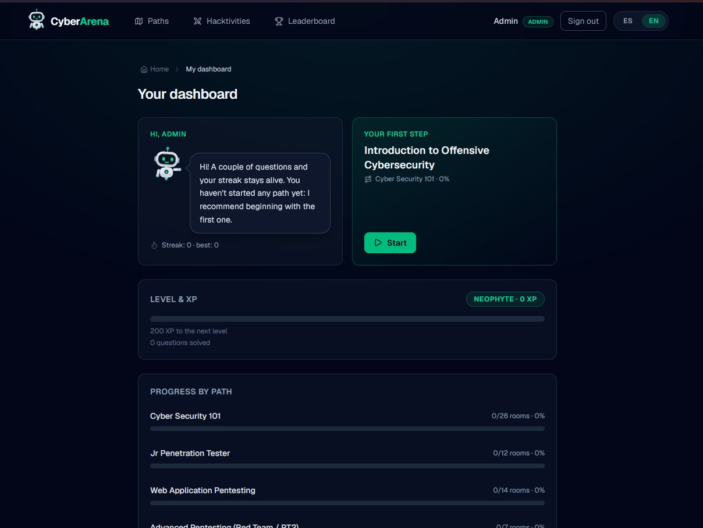

<div align="center">

# CyberArena

**An open-source, self-hosted platform to learn cybersecurity by doing.**<br>
Guided learning paths, interactive rooms with flags, gamified progress and isolated Docker labs that start
on demand from the browser.

[](https://github.com/adriandy89/tryhackme/actions/workflows/ci.yml)
[](https://github.com/adriandy89/tryhackme/actions/workflows/e2e.yml)
[](LICENSE)




</div>

## Contents

- [Features](#features)
- [Learning content](#learning-content)
- [Architecture](#architecture)
- [Getting started](#getting-started)
- [Hands-on labs](#hands-on-labs)
- [Deployment](#deployment)
- [Development](#development)
- [Project structure](#project-structure)
- [Documentation](#documentation)
- [Security](#security)
- [Contributing](#contributing)
- [License](#license)

## Features

- **Learning paths, novice to advanced:** four paths made of modules and rooms. Each room combines
  theory, tasks and questions (flags, free text or multiple choice) with hints and instant feedback.
- **Hands-on labs on demand:** 39 deliberately vulnerable environments, one Docker Compose project each.
  Students start them from the room page. A lab is shared by everyone using it and **shuts down by itself**
  when nobody does.
- **Gamification:** XP, 21 levels, badges, daily streaks, a leaderboard and PDF certificates with a
  verification code.
- **Bilingual:** the whole UI and all the content in Spanish and English.
- **Built-in admin:** an initial admin account, a view of the running labs and their reservations, an
  emergency stop and a public status page.
- **Secure by design:**
  - answers are stored hashed and never reach the browser;
  - per-IP rate limiting;
  - hardened containers (no capabilities, `no-new-privileges`, resource limits) on segmented networks;
  - a single, locked-down service is allowed to talk to Docker.

## Learning content

| Path | Level | Modules | Rooms |
|---|---|---|---|
| Cyber Security 101 | Beginner | 14 | 26 |
| Jr Penetration Tester | Intermediate | 10 | 12 |
| Web Application Pentesting | Intermediate–Advanced | 7 | 14 |
| Advanced Pentesting (Red Team / PT2) | Advanced | 6 | 7 |

In total: 59 rooms, 162 tasks and 491 questions. Topics include Linux and Windows, networking,
cryptography, the OWASP Top 10 (2025), APIs, Active Directory, privilege escalation, pivoting, containers
and cloud, malware analysis and AI/LLM security.

All content is original and lives in the repository as code (MDX plus YAML), validated at build time.

## Architecture

```
                 ┌──────────────────────────── Docker host ────────────────────────────┐
 Browser ──────► │ Caddy (TLS) ──► web (Next.js 16) ──/api──► api (NestJS 12) ──► PostgreSQL 18
                 │                                             │ internal network, token
                 │                                             ▼
                 │                                        lab-runner ──► Docker ──► labs/<slug>
                 └──────────────────────────────────────────────────────────────────────┘
```

| Layer | Technology |
|---|---|
| Monorepo | pnpm 11 workspaces, Turborepo 2, TypeScript 5.9 |
| Web | Next.js 16 (App Router), React 19, next-intl, Tailwind CSS 4 |
| API | NestJS 12, Zod 4, Better Auth, Prisma 7 |
| Database | PostgreSQL 18 |
| Labs | Docker Compose, one isolated project per lab, controlled by `apps/lab-runner` |
| Delivery | Multi-stage Docker images, Caddy (HTTPS), GitHub Actions |

- **web:** renders the site and forwards `/api` to the api.
- **api:** owns authentication, progress, gamification and lab reservations. A background reaper stops idle
  labs.
- **lab-runner:** the only service with access to the Docker socket. It starts and stops labs from a
  manifest built into its image and keeps its own deadlines, so labs stop even if the api goes down.

More in [docs/architecture.md](docs/architecture.md).

## Getting started

### Prerequisites

- [Docker](https://docs.docker.com/get-docker/) with Docker Engine 26+ and Compose 2.24.4+. On Windows and
  macOS, use Docker Desktop.
- Git.
- For option B only: [Node.js](https://nodejs.org/) 22+ and pnpm 11 (`corepack enable`).
- Free local ports: `3000` (web), `3001` (api), `5432` (PostgreSQL), `8025` and `1025` (Mailpit).

On Windows, run the commands in **Git Bash**.

### Option A — everything in Docker (recommended)

You only need Docker. The code is mounted into the containers with hot reload.

1. **Clone the repository**

   ```bash
   git clone https://github.com/adriandy89/tryhackme.git cyberarena
   cd cyberarena
   ```

2. **Create the environment file**

   ```bash
   cp infra/stacks/dev/.env.example infra/stacks/dev/.env
   ```

   The defaults work as they are. Optionally, set `BOOTSTRAP_ADMIN_PASSWORD` (8+ characters) to choose the
   admin password.

3. **Start the stack**

   ```bash
   docker compose --project-directory . -f infra/stacks/dev/compose.yaml --env-file infra/stacks/dev/.env up -d
   ```

   The first start takes a few minutes: it installs dependencies, builds the shared packages, creates the
   database and loads the content. The command returns once the api is ready; the web needs about one more
   minute to compile on the first visit. Later starts take seconds.

4. **Get the admin credentials**

   The admin account is `admin@cyberarena.local`. If you did not set a password, read the generated one
   from the api log:

   ```bash
   docker compose --project-directory . -f infra/stacks/dev/compose.yaml --env-file infra/stacks/dev/.env logs api | grep "initial admin"
   ```

5. **Open the app**

   | URL | What |
   |---|---|
   | http://localhost:3000 | CyberArena (`/es` and `/en`) |
   | http://localhost:3000/api/health | API health |
   | http://localhost:8025 | Mailpit, which catches outgoing emails |

To stop the stack, run the same command with `down` instead of `up -d`; your data is kept. Add `-v` to also
delete the database.

### Option B — apps on your machine

Only the database and the mail catcher run in Docker. This gives the fastest feedback loop, especially on
Windows and macOS.

1. **Clone, install and configure**

   ```bash
   git clone https://github.com/adriandy89/tryhackme.git cyberarena
   cd cyberarena
   corepack enable
   pnpm install
   cp .env.example .env
   cp infra/stacks/dev/.env.example infra/stacks/dev/.env
   ```

2. **Start PostgreSQL and Mailpit**

   ```bash
   docker compose --project-directory . -f infra/stacks/dev/compose.yaml --env-file infra/stacks/dev/.env up -d postgres mailpit
   ```

3. **Build, create the database and load the content**

   ```bash
   pnpm build
   pnpm db:migrate
   pnpm db:seed
   ```

4. **Run the apps**

   ```bash
   pnpm dev
   ```

   The web runs on http://localhost:3000 and the api on http://localhost:3001. The admin password is
   printed in the output the first time (look for `initial admin`), unless you set
   `BOOTSTRAP_ADMIN_PASSWORD` in `.env`.

> Changed the content? Run `pnpm --filter @repo/content build && pnpm db:seed`. The seed is idempotent.
> In option A, `docker compose ... restart api` does the same.

## Hands-on labs

Labs are off by default; the room page then shows the `docker compose` commands to run a lab by hand.

To start and stop labs from the browser in the development stack:

1. Create the flag files the runner reads:

   ```bash
   bash infra/scripts/lab-flags.sh infra/stacks/dev/lab-flags
   ```

2. In `infra/stacks/dev/.env`, set `LABS_ENABLED=true` and `LAB_RUNNER_TOKEN` (32+ characters, for
   example the output of `openssl rand -hex 32`).

3. Start the stack with the `labs` profile:

   ```bash
   docker compose --project-directory . -f infra/stacks/dev/compose.yaml --env-file infra/stacks/dev/.env --profile labs up -d
   ```

**Default policy:**

- a lab stops 10 minutes after the last open room page that uses it closes;
- a session lasts 2 hours and can be extended up to 4;
- each user can run one lab at a time;
- the server runs at most 3 labs.

Lab ports are published on `127.0.0.1` only. Run a single lab-runner per Docker host.

## Deployment

Production builds multi-stage images and uses Docker secrets, internal networks and automatic database
migrations at start-up. Two layouts are ready to use:

- **Server with HTTPS:** `infra/stacks/proxy` (Caddy, automatic or internal certificates) plus
  `infra/stacks/prod` (PostgreSQL, api, web and lab-runner). The full procedure is in
  [docs/runbook.md](docs/runbook.md):
  - secrets;
  - preflight checks;
  - deployment;
  - content seed;
  - smoke tests;
  - backups and restores.
- **Home lab or LAN server without a proxy:** [`infra/stacks/lan`](infra/stacks/lan/README.md) serves
  the web on its own port and the labs on the server's LAN IP. Its configuration lives outside the clone,
  so `git pull` never conflicts. A single script handles `init`, `up`, `update`, `backup` and `labs`.

## Development

| Command | What it does |
|---|---|
| `pnpm dev` | Web and api in watch mode |
| `pnpm lint && pnpm typecheck && pnpm test && pnpm build` | The full check that CI runs |
| `pnpm test:e2e` | Playwright end-to-end tests |
| `pnpm db:migrate` / `pnpm db:seed` | Apply migrations / load the content |
| `pnpm --filter @repo/content build` | Validate and compile the content |

The project follows **Spec-Driven Development**. `specs/` holds the constitution, the roadmap and one
folder per phase (spec, plan and tasks), and architectural decisions are recorded in `docs/adr/`. Read
[CONTRIBUTING.md](CONTRIBUTING.md), and [AGENTS.md](AGENTS.md) if you use AI coding agents.

## Project structure

```
apps/
  web/          Next.js app: catalog, room player, dashboard, admin
  api/          NestJS REST API: auth, progress, gamification, labs
  lab-runner/   The only service allowed to drive Docker for the labs
packages/
  content/      Rooms and paths as code (MDX + YAML) and the build that validates them
  database/     Prisma schema, migrations and seed
  shared/       Contracts shared by web and api (types, XP and levels, lab states)
  ui/           Shared React components
  config/       Shared TypeScript and ESLint configuration
labs/           One isolated Docker Compose project per lab
infra/          Docker stacks (dev, prod, proxy, lan) and operations scripts
specs/          Specifications: constitution, roadmap, one folder per phase
docs/           Architecture, runbook, content guide and ADRs
```

## Documentation

| Document | Contents |
|---|---|
| [docs/architecture.md](docs/architecture.md) | System overview, data flow and security model |
| [docs/runbook.md](docs/runbook.md) | Development, production, labs, backups and troubleshooting |
| [docs/content-guide.md](docs/content-guide.md) | How to write paths, rooms, questions and labs |
| [docs/adr/](docs/adr/) | Architecture decision records |
| [specs/ROADMAP.md](specs/ROADMAP.md) | Phases and their status |

These documents are written in Spanish; the code and its comments are in English.

## Security

- The applications under `labs/` are **vulnerable on purpose**. Keep them on `127.0.0.1` or on a network
  you trust, and never expose them to the internet.
- The answers and flags are part of the repository (content as code). CyberArena is a learning platform,
  not a competitive CTF.
- Found a vulnerability in the platform itself? Report it privately as described in
  [SECURITY.md](SECURITY.md).

## Contributing

Contributions are welcome: new rooms, translations, labs, bug fixes and features. Start with
[CONTRIBUTING.md](CONTRIBUTING.md).

## License

[MIT](LICENSE).

CyberArena is an independent project, inspired by hands-on training platforms. It is not affiliated with or
endorsed by TryHackMe or any other company. Use what you learn only on systems you own or are explicitly
authorized to test.
